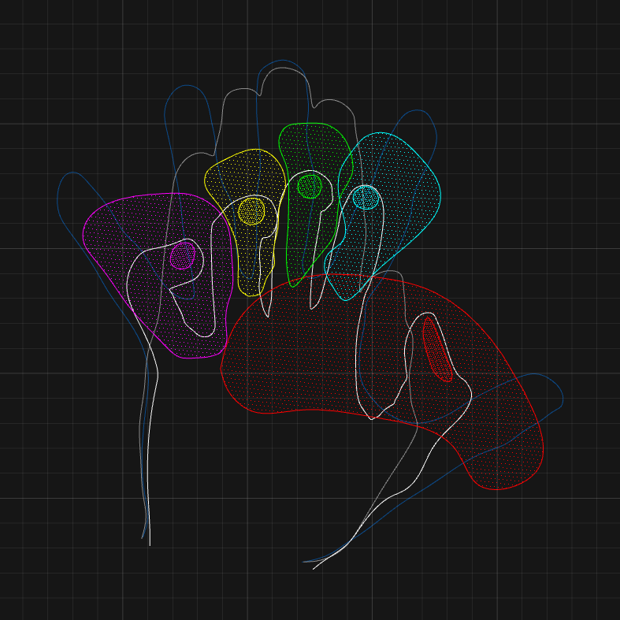

<!--
SPDX-FileCopyrightText: 2026 Paul Bunch
SPDX-License-Identifier: CERN-OHL-P-2.0
-->

# Keeb Flat Proto

A minimalist, wired, split keyboard prototype designed to validate ergonomic concepts for a future membrane keyboard.

*Left-hand finger reach zones used as the basis for key placement*

## Project Goals

The `keeb-flat-proto` (Flat Prototype) serves as an MVP to test unique ergonomic hypotheses before committing to a complex membrane or 3D-curved design.

- **Anatomic Key Placement:** Moving away from standard grids to match the natural, relaxed position of the hands and the actual reach of each finger.
- **Adaptive Key Sizing:** Exploring the use of non-standard key sizes and shapes that adapt to the finger's range of motion.
- **Microswitch Driven:** Using silent microswitches instead of traditional mechanical switches. This gives a lower profile, frees the layout from the 19×19 mm grid, and keeps the keyboard quiet.
- **Ultra-Low Cost:** Point-to-point hand-wiring with stiff wire laid into integrated channels within an FDM-printed case. No PCBs, no wireless, no batteries.

## Key Concepts

### 1. Motion-Based Layout
Keys are placed strictly within the reach zones of each finger while the other four fingers remain stationary. This minimizes hand strain and unnecessary movement.

Detailed analysis: [Finger Motion Zones and Layout Principles](docs/ergonomics.md).

### 2. Adaptive Geometry
Traditional mechanical switches force a uniform grid. By using microswitches, this project explores placing the centers of the keys exactly where the finger lands most comfortably, allowing for varying keycap sizes and spacing.

### 3. Rigid Hand-Wiring
The internal structure features pre-designed channels for routing rigid wires. This provides structural integrity and a clean build without the expense of a custom PCB.

## Status

Work in progress — see the [Roadmap](docs/roadmap.md) for current progress and next steps.

## Related Projects

- [homerow-layers](https://github.com/PaulBunch/homerow-layers) — Software multi-layer layout (US/RU) for conventional keyboards. Shares the same ergonomic philosophy.

## License

This project is licensed under the **CERN Open Hardware Licence Version 2 – Permissive** (CERN-OHL-P-2.0).

See the [LICENSE](LICENSE) file for the full text.
