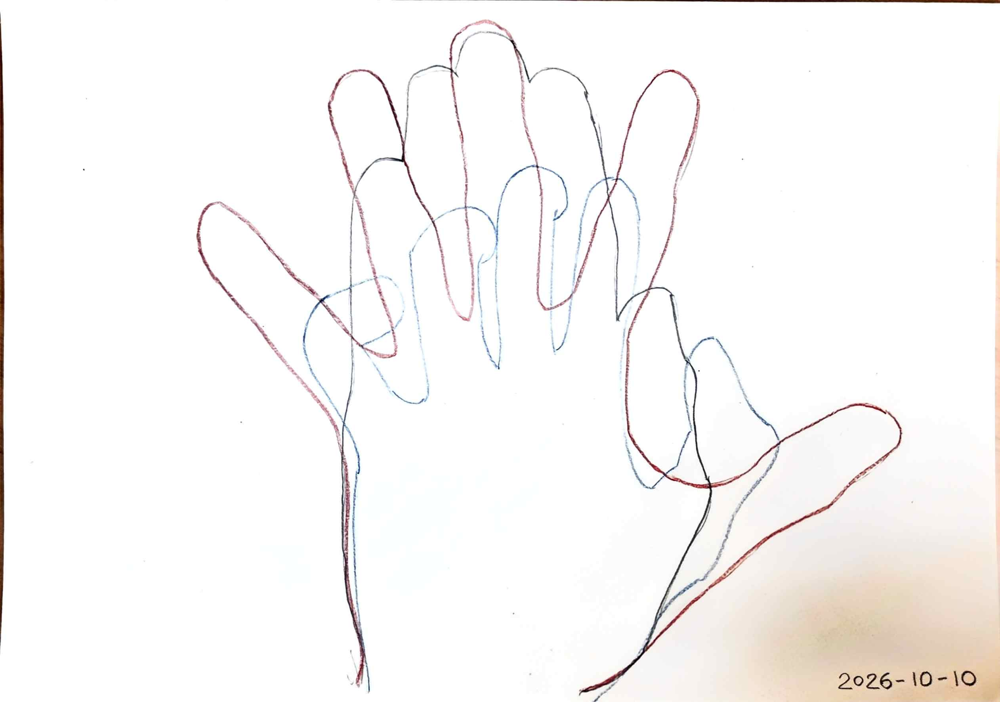
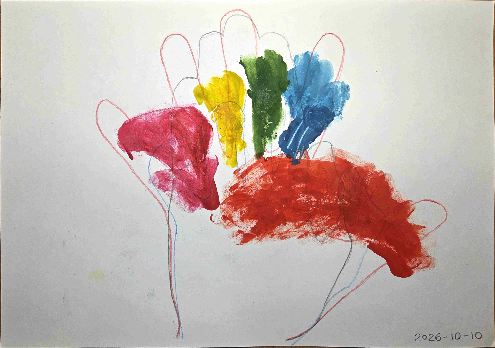

<!--
SPDX-FileCopyrightText: 2026 Paul Bunch
SPDX-License-Identifier: CERN-OHL-P-2.0
-->

# Finger Motion Zones and Layout Principles

> [Читать на русском](ergonomics.ru.md)

These notes are based on the analysis of the [finger motion map](../cad/ergonomics/finger-zones.dxf). The study was conducted for the left hand. Each finger’s reach zone was recorded while the other four fingers remained stationary (simulating a normal typing posture).

*Fig. 1. Left-hand resting positions*

*Fig. 2. Finger trajectories and reach zones with a stationary palm*

## Key Observations and Principles

### 1. Vertical Zoning (Column Stagger)

* **Bottom row:** When the four non-thumb fingers move downward, their horizontal reach narrows.
  * *Conclusion:* It is advisable to place only one key per finger on the bottom row.

* **Home and upper rows:** Horizontal reach expands in these rows.
  * *Conclusion:* For the index finger and especially the pinky (which has the largest zone), two keys per row are practical (additional inner/outer columns).

### 2. Thumb Cluster

* The thumb has the largest motion zone — comparable in area to the combined zones of the other four fingers.
* The portion of the zone that lies under the palm remains reachable, but is most comfortable when the hand is slightly elevated.
  * *Conclusion:* Using two rows of keys in the thumb cluster is well justified.

### 3. Column Geometry and Fan Layout (Splay)

* **Column spacing:** Placing adjacent columns tightly against each other does not feel natural.
* **Intra-finger vs inter-finger distance:** The distance between columns served by the same finger (index or pinky) should be smaller than the distance between columns served by different fingers.
* **Natural splay:** The motion zones form a natural fan shape.
  * *Conclusion:* Columns should not only be staggered vertically but also slightly angled relative to each other so that the key travel axes align with the natural joint trajectories. This also applies to the index-finger columns, which in most layouts are made parallel to the middle-finger column — a common simplification that does not fully match the hand’s anatomy.

### 4. Discreteness and Comfort

* **Adaptive centers:** A continuous painted zone does not mean equal comfort at every point. Inside each zone there are discrete points of most natural finger placement.
  * *Principle:* Key centers should be located at these “maximum comfort” points, even if this results in uneven gaps between keys.

* **Pinky:** Among the four non-thumb fingers, the pinky has the largest motion zone — a fact often underestimated in conventional layouts.
